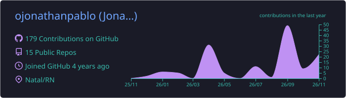
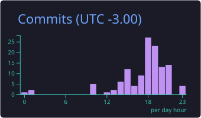
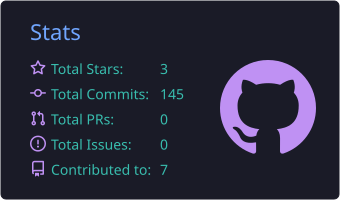
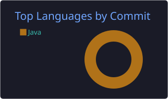
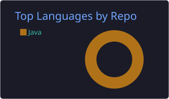

<h1 align="center">Olá, eu sou o Jonathan Pablo 👋</h1>

  <b>Desenvolvedor Java Pleno</b> · Spring Boot · Microsserviços · DDD · Natal/RN

  
  
  

---

### 🧑‍💻 Sobre mim

- Desenvolvo back-end em **Java** com foco em **microsserviços**, **Domain-Driven Design** e **arquitetura hexagonal**.
- Gosto de código que conta a regra de negócio: agregados ricos, value objects e testes que documentam o comportamento.
- Hoje estou me aprofundando em **microsserviços orientados a eventos** e **IA aplicada a sistemas Java** (LangChain4j, MCP).

### 🛠️ Stack

  
  
  
  
  
  
  
  
  

### 🚀 Projetos em destaque

| Projeto | O que é |
|---|---|
| [**algashop-meta**](https://github.com/ojonathanpablo/algashop-meta) | E-commerce em microsserviços. O serviço de pedidos ([ordering](https://github.com/ojonathanpablo/ordering)) usa DDD tático (agregados, value objects, domain services), arquitetura hexagonal, camada anticorrupção para frete via RestClient + WireMock e testes unitários e de integração. |
| [**agencia-viagem-demo**](https://github.com/ojonathanpablo/agencia-viagem-demo) | Assistente de IA para agência de viagens que evolui de monolito para microsserviços conversando via **MCP**. Quarkus, LangChain4j e Ollama. |
| [**algasensors-meta**](https://github.com/ojonathanpablo/algasensors-meta) | Microsserviços de monitoramento de sensores de temperatura: gestão de dispositivos, processamento e monitoramento. |

### 📊 Quanto eu codifico

  

  
  

  
  

  

